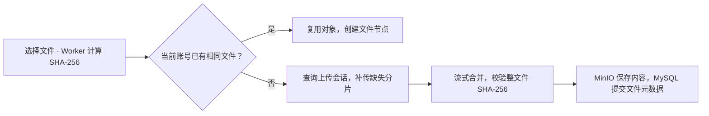

# 个人云盘

基于 Spring Boot、Vue 和 MinIO 的文件管理系统。大文件上传中断后，重新选择原文件即可继续传输缺失分片。文件与目录可通过带有效期或提取码的链接分享，访客打开链接后即可预览或下载授权内容。

**Java 17 · Spring Boot 3 · Spring Security · MyBatis-Plus · MySQL · MinIO · Vue 3 · Pinia · PDF.js**

## 工程亮点

- **中断后恢复上传。** 浏览器在 Web Worker 中计算 SHA-256，按账号保存上传任务的元数据。重新选择文件时，前端对比原文件哈希和服务端已保存的分片，只发送缺失分片。完成时流式读取 MinIO 中的分片，同时校验完整文件哈希。[前端上传状态](frontend/src/stores/uploads.js) · [服务端合并与校验](backend/src/main/java/com/airuike/netdisk/backend/service/ChunkUploadService.java)
- **账号内秒传与重试。** 同一账号已持有相同 SHA-256 和大小的有效文件时，新文件节点复用 MinIO 对象并增加引用计数。上传会话通过客户端任务标识去重，合并租约处理失败重试，后台回收超时分片及无引用对象。[会话状态](backend/src/main/java/com/airuike/netdisk/backend/service/UploadSessionTransactions.java) · [对象与引用计数](backend/src/main/java/com/airuike/netdisk/backend/service/UploadTransactionService.java)
- **有边界的匿名分享。** 文件和目录分享支持到期、提取码和撤销。访客授权限定在链接指向的文件或目录树内，下载使用短时票据。文件工作台还支持搜索、分类、在线预览与回收站恢复。[分享授权](backend/src/main/java/com/airuike/netdisk/backend/service/ShareService.java) · [访客接口](backend/src/main/java/com/airuike/netdisk/backend/controller/PublicShareController.java)



## 本地运行

需要 JDK 17、Docker Compose v2 和 Node.js 22.22.2+（22.x）或 24.15.0+（24.x）。以下命令在 Bash 中执行。

1. 从仓库根目录创建本机配置。编辑 `infra/.env`，为 MySQL 和 MinIO 分别设置密码。可用 `openssl rand -hex 24` 生成各个密码，用 `openssl rand -base64 32` 生成 `NETDISK_JWT_SECRET`。

   ```bash
   test -f infra/.env || install -m 600 infra/.env.example infra/.env
   ```

2. 保存配置后启动数据服务。Compose 首次从固定上游版本构建 MinIO。本地 MySQL 在首次创建数据卷时自动执行建表脚本。[MinIO 上游版本](https://github.com/minio/minio/releases/tag/RELEASE.2025-10-15T17-29-55Z) · [核心表](database/01-core.sql) · [分享与上传表](database/08-10-share-upload.sql)

   ```bash
   docker compose --env-file infra/.env -f infra/compose.yaml up -d --build --wait
   ```

   打开 MinIO 控制台 `http://127.0.0.1:9001`，使用 `NETDISK_MINIO_ACCESS_KEY` 和 `NETDISK_MINIO_SECRET_KEY` 登录，创建名为 `netdisk` 的存储桶。

3. 启动后端。

   ```bash
   set -a
   . ./infra/.env
   set +a
   cd backend
   ./mvnw spring-boot:run
   ```

4. 在另一终端启动前端。打开 `http://127.0.0.1:5173`，注册后即可管理文件。Vite 将 `/api` 请求代理到本机 8080。

   ```bash
   cd frontend
   npm ci
   npm run dev
   ```

## 验证

发布版通过 57 项后端测试，覆盖分片校验、恢复、取消、账号内秒传、分享授权和回收站。后端套件使用 H2 和内存对象存储，两项前端静态检查及 Vite 构建也已通过。

在本地 MySQL + MinIO 联调中，上传 32 MiB 文件时先提交第 0、1 片，恢复会话后只提交第 2、3 片，合并后的下载文件与原文件 SHA-256 一致。账号内秒传、提取码校验、分享下载及撤销也通过实测。

```bash
(cd backend && ./mvnw test)
(cd frontend && npm ci && npx --no-install eslint src && npx --no-install oxlint src && npm run build)
```

默认分片大小为 8 MiB，分片上传单文件配置上限为 5 GiB，未完成会话有效期为 72 小时。[上传配置](backend/src/main/resources/application.properties)
